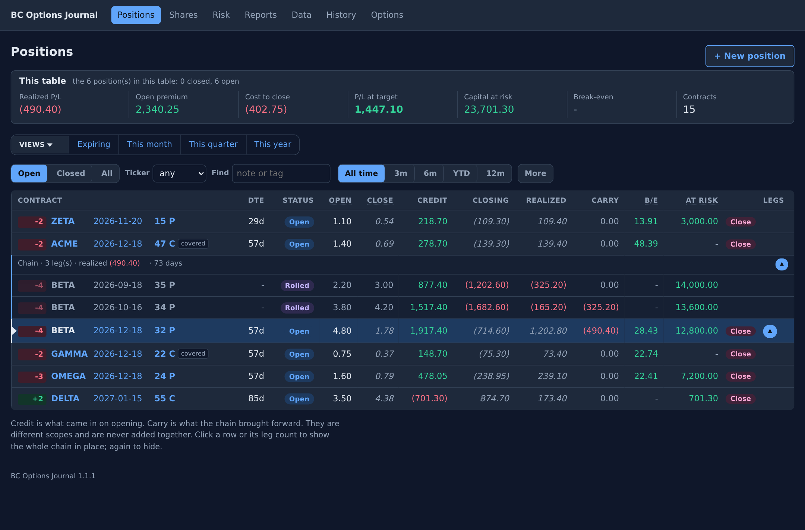
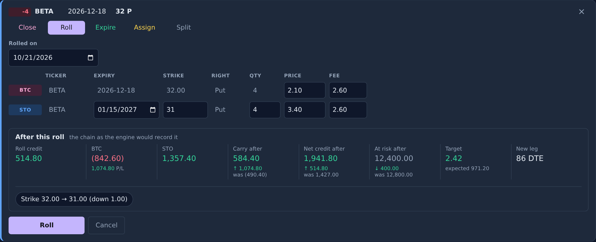
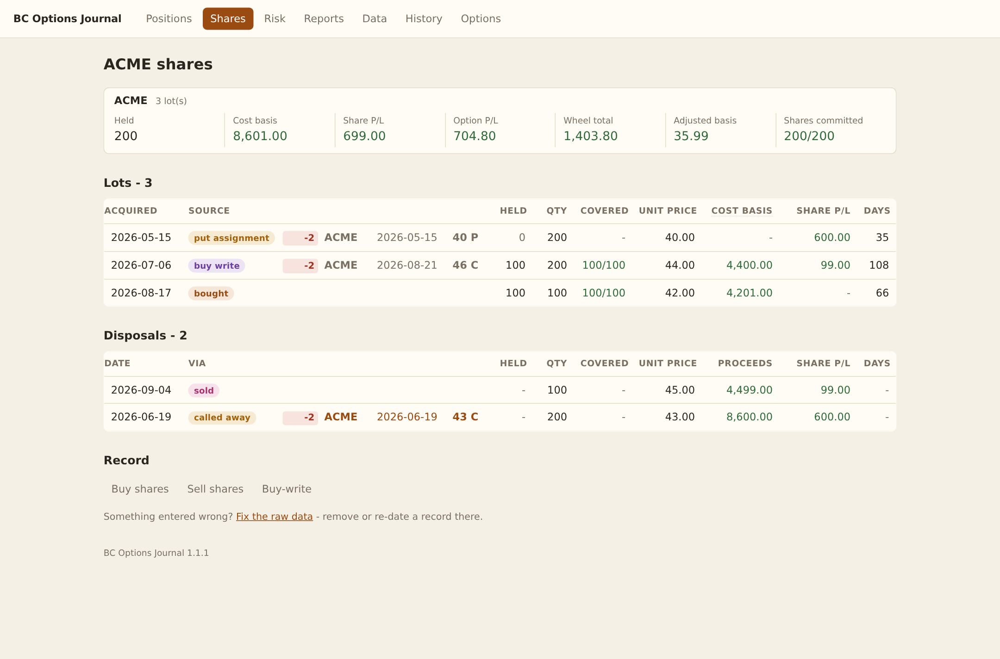
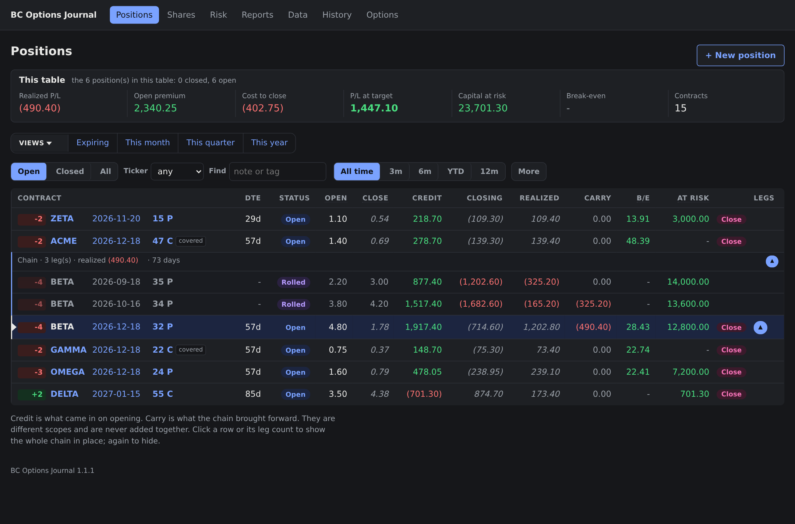
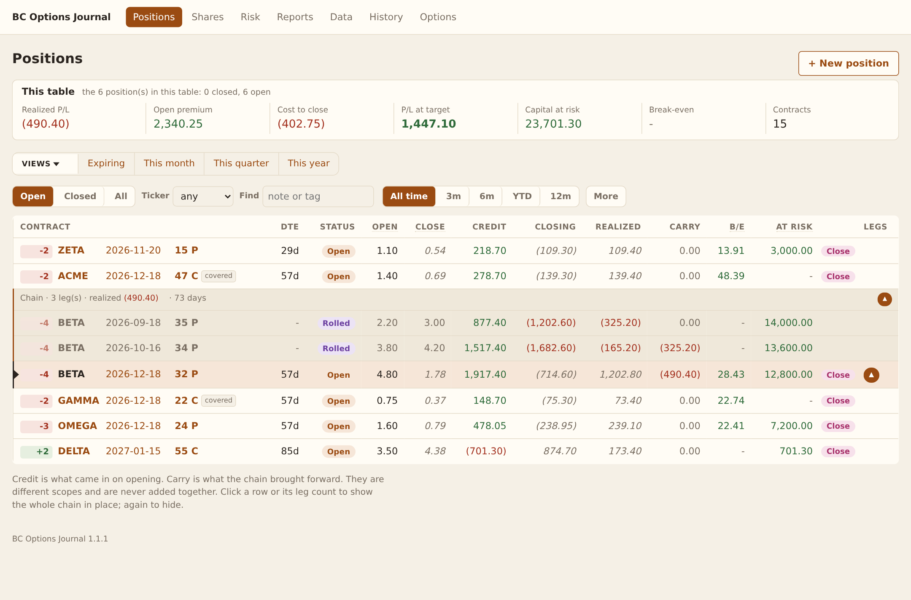

# BC Options Trade Journal

A self-hosted options journal that tracks profit and loss across rolls,
partial assignments, covered calls, and share disposals. Built with Python's
standard library and SQLite, with a browser UI and reversible trade entry.

[](https://github.com/binhcoi/BCOptionsJournal/actions/workflows/ci.yml)



*All screenshots use fictional tickers and synthetic trades.*

## What it does

- **Follow a trade across rolls and splits.** Keep each leg's realized P/L
  separate from the result carried through its chain.
- **Track shares alongside options.** Assignment creates or disposes of
  shares; lots, coverage, cost basis, and realized share P/L stay connected.
- **Preview a roll before recording it.** See fee-inclusive closing and
  opening totals, the resulting carry, net credit, risk, and profit target.
- **Review performance and exposure.** Filter positions, save views, and
  inspect realized results by period and ticker, plus obligations by expiry.
- **Correct records with an audit trail.** Undo a complete action, inspect
  data-quality flags, and take or restore consistent SQLite snapshots.

### Roll preview

The preview runs the same trade action used to record a roll, on an in-memory
copy. Changing quantity, premium, or fees updates the result before submission.



### Share accounting

Share lots and disposals show acquisition source, unit price, cost basis,
coverage, and realized P/L. Option P/L and share P/L are reported separately
before the ticker's wheel total.



### Themes

The views above show slate for positions and rolls, and paper for shares.
Dark provides another option for the same workflows. The System setting
follows the device's light or dark preference.

<details>
<summary>Compare slate, dark, and paper</summary>

| Slate | Dark | Paper |
| --- | --- | --- |
| [](docs/screenshots/positions.png) | [](docs/screenshots/positions-dark.png) | [](docs/screenshots/positions-paper.png) |

</details>

## Run locally

Requires Python 3.10 or newer. The application has no third-party runtime
dependencies or external services.

```bash
git clone https://github.com/binhcoi/BCOptionsJournal.git
cd BCOptionsJournal
python3 -m bcoj.web --db journal.db
```

Open <http://127.0.0.1:8000>. Sign in with the initial password `bcoj`, then
choose a new password when prompted. The SQLite journal is created on first
start.

For Docker, release packages, network access, and backups, see the
[deployment guide](docs/deploy.md).

## Engineering choices

| Choice | Purpose |
| --- | --- |
| `Decimal` money, persisted as SQLite `TEXT` | Keep monetary arithmetic and stored values exact; round explicitly at accounting boundaries. |
| Calculation engine independent of storage and HTTP | Test accounting rules directly and reuse them in the UI, importer, reports, and roll preview. |
| SQLite transactions and grouped audit entries | Record related changes together and undo an action without leaving part of it applied. |
| Server-rendered HTML with progressive JavaScript | Keep forms usable without JavaScript while enabling inline actions and partial page updates. |
| Reconciliation before import | Compare imported derived values with independently calculated results and retain discrepancies as flags. |
| Versioned migrations and SQLite's backup API | Upgrade schema explicitly and produce consistent snapshots while the app is running. |

The standard-library stack fits a single-user journal: one process, one data
file, and a calculation layer with no network dependencies. The design and
its tradeoffs are described in [plan.md](plan.md).

## Verification

```bash
python3 -m unittest discover -s tests -q
python3 -m bcoj.cli reconcile tests/fixtures/synthetic_rows.csv
```

The suite covers monetary calculations, roll and split invariants, share
matching, storage, migrations, authentication, and real HTTP requests against
temporary databases. The synthetic CSV fixture contains independently
calculated expected results and deliberate data-quality cases. CI runs the
suite on Python 3.10 and 3.12.

## Documentation

| Document | Contents |
| --- | --- |
| [Design](plan.md) | Architecture, accounting rules, model, constraints, and planned work. |
| [Deployment](docs/deploy.md) | Source and container hosting, authentication, releases, backup, and restore. |
| [Legacy import](docs/legacy-format.md) | CLI workflow, input columns, reconciliation, and data-quality handling. |

## Data and scope

The public fixture and screenshots are synthetic. Local journals, exports,
and reconstructed-lot configuration belong outside version control;
`private/`, SQLite files, and CSV files outside `tests/fixtures/` are ignored.

The app supports manual trade journaling for one user. It does not fetch live
prices, synchronize with a broker, calculate a marked-to-market portfolio
value, or provide tax reporting.

## License

[MIT](LICENSE)
